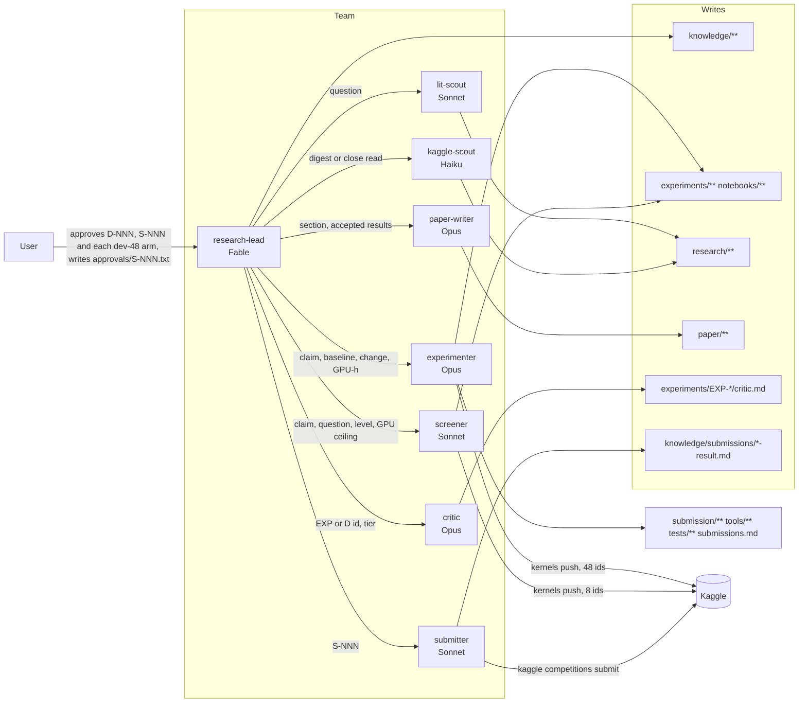
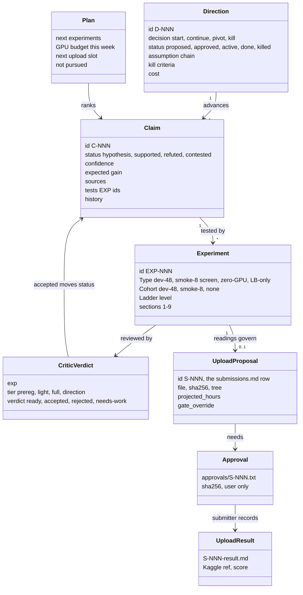
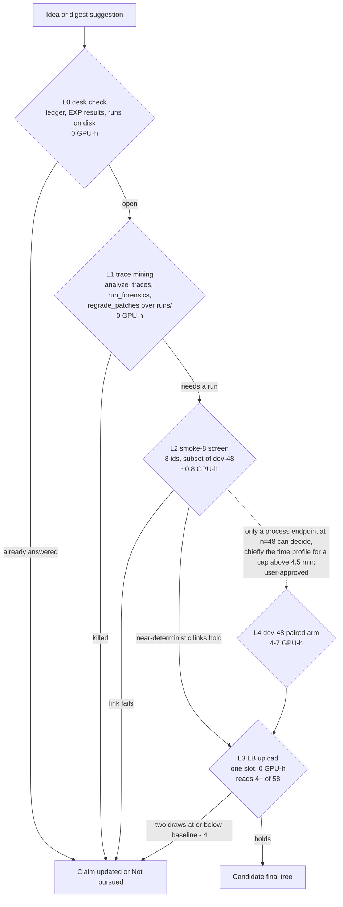
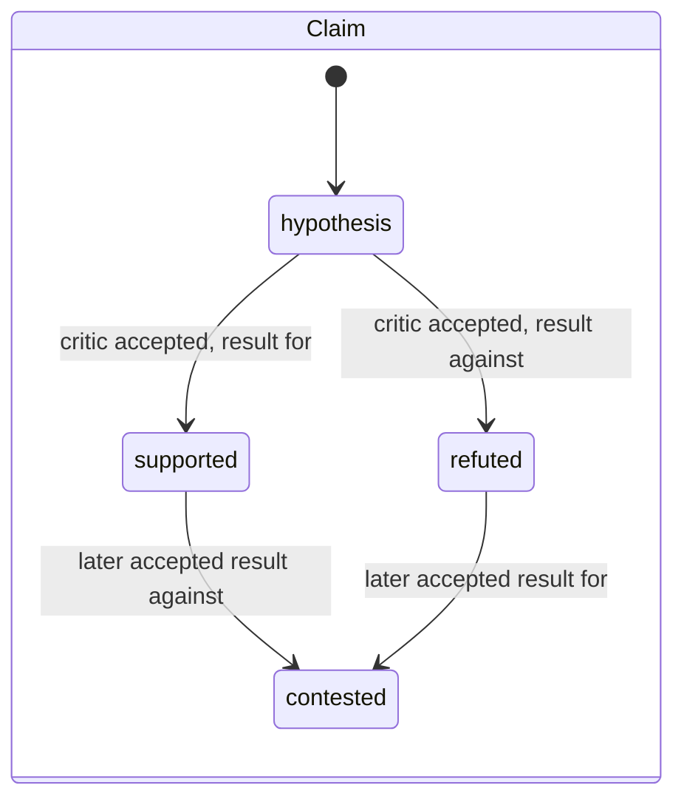
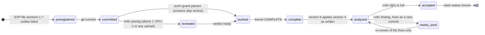

# The research agent team: how it works

How this repo's Claude Code agents turn ideas into leaderboard uploads while spending as little GPU time as
possible. CLAUDE.md holds the short version and the file paths; this document is the design. Diagrams are
Mermaid and render on GitHub. Dated 2026-11-03.

## 1. Principles

1. **Lean.** The scarce resources are 30 L4x4 GPU-hours a week, one leaderboard upload per UTC day, and the
   calendar (paper Nov 12, freeze Nov 30, last upload Dec 1). Ideas are killed by reading before they are
   tested by running; a kernel is the last resort, not the first.
2. **Pre-registered.** Every experiment's design, endpoints and decision readings are committed before the
   kernel is pushed or the zip uploaded, and are never revised. Results are appended and read against the
   readings as written.
3. **Independently reviewed.** A critic that starts with no memory of why the designer wanted a result reviews
   every expensive pre-registration and every result that moves a claim. Only its `accepted` verdict changes a
   claim's status.
4. **Enforced, not trusted.** Write boundaries, command allowlists, the pre-registration rule, the cohort size
   and the upload approval are checked by hook scripts, in milliseconds, before the tool runs.
5. **Nothing evaporates.** Every suggestion from a digest or a paper becomes a claim or a "Not pursued" line
   with a reason, so no question is researched twice.
6. **Assume, then discharge.** A direction states the chain of assumptions under which it reaches its goal; each
   link is measured by the cheapest instrument that can read it (D-004 is the worked example).

## 2. Components



| Agent | Model, effort | Skills | Writes only | Bash allowed |
|---|---|---|---|---|
| research-lead | Fable, xhigh | competition-brief, logbook-conventions, direction-review | `knowledge/**` | git status/log/diff/add/commit/push; `kaggle competitions submissions`; `kaggle kernels status` |
| critic | Opus, xhigh | + harness-stack, critique-checklist | `experiments/EXP-*/critic.md` | unrestricted, read-only by role |
| screener | Sonnet, high | competition-brief, harness-stack, experiment-protocol | `experiments/**`, `notebooks/**`, `out/**`, `dist/**` | `python tools/`, `python -I -X utf8 tools/`, pytest, kernels push/status/output, git status/log/diff/add/commit/ls-files, diff, cp, ls, wc, sha256sum, cat, head, tail, grep |
| experimenter | Opus, high | + harness-stack, experiment-protocol | screener's paths + `submission/**`, `tools/**`, `tests/**`, `submissions.md`, harness-stack skill | unrestricted; pushes pass the push guard |
| kaggle-scout | Haiku, high (Sonnet per dispatch for close reads) | + kaggle-digest | `research/kaggle/**` | kaggle topics/leaderboard/kernels list+pull/datasets; `python -I -X utf8` |
| lit-scout | Sonnet, high | + paper-reading | `research/lit/**` | none (web tools) |
| paper-writer | Opus, xhigh | + paper-track | `paper/**` | export_release_csv, analyze_traces, exp024_stats, wc, git log/show/diff |
| submitter | Sonnet | none | `knowledge/submissions/*-result.md` | kaggle competitions submit/submissions, sha256sum, cp |

The lead is the only agent that spawns others. Subagents start cold (`CLAUDE_CODE_FORK_SUBAGENT=0`): each
loads its own prompt and skills, about 2,500 to 3,500 words, and nothing of the lead's conversation. Bundled
skills and plugins are disabled at the project level so an agent sees only the skills listed for it.

## 3. The knowledge layer



Owners: the lead writes claims, directions, plan, briefing, user-decisions and S-NNN proposals; the experimenter
and screener write EXP files; the critic writes verdicts; the submitter writes results; the user alone writes
approvals. `knowledge/INDEX.md` and `research/INDEX.md` are regenerated by a hook after every write and are
what the lead reads first, instead of the 2,600-word ledger.

## 4. The loop

The lead runs its loop when something lands, not on a timer: a kernel completes, a grade appears, a verdict is
written, a digest arrives, the user decides.

```mermaid
sequenceDiagram
    autonumber
    participant U as User
    participant L as research-lead
    participant SC as screener
    participant C as critic
    participant E as experimenter
    participant K as Kaggle
    participant SU as submitter
    L->>L: read INDEX files, digest, verdicts, submissions, kernel status
    L->>L: new findings become claims or Not-pursued lines; rank
    L->>SC: claim C-NNN, question, level L0-L2, GPU ceiling
    SC->>SC: desk check, trace mining over runs/
    alt needs a smoke run
        SC->>SC: pre-register EXP (Cohort smoke-8), commit
        SC->>K: kernels push (8 ids; push guard checks cohort)
        SC-->>L: pushed, analysis pending
        L->>L: later: kernels status COMPLETE
        L->>SC: download and analyze EXP-NNN
    end
    SC-->>L: killed, or promoted with the next rung
    alt promoted to an upload
        L->>E: pack candidate, write pending submissions.md row
        E-->>L: file, sha256
        L->>C: prereg review of the EXP whose readings govern the draw
        C-->>L: ready or needs-work
        L->>U: S-NNN proposal; asks for a one-line prediction
        U->>U: writes approvals/S-NNN.txt with the sha256
        L->>SU: S-NNN
        SU->>K: competitions submit (submit guard: submitter, approval, sha, filename)
        SU-->>L: S-NNN-result.md
    else promoted to a dev-48 arm (rare)
        L->>U: the question n=8 and one LB draw cannot read; hours vs ledger
        U-->>L: approves
        L->>E: pre-register, build, push (returns at push)
        L->>E: later: download and analyze
        E-->>L: section 9, readings applied
        L->>C: full review
        C-->>L: accepted, rejected or needs-work
    end
    L->>L: update claims, plan (GPU ledger), briefing; commit the logbook
```

## 5. The screening ladder



What each level can read is fixed in the experiment-protocol skill. At n = 8 only near-deterministic outcomes
count: a knob is enforced, a cap is breached, a route breaks, a behaviour shows in all 8 or in none. Resolves on
8 tasks are recorded and never an endpoint. The order puts the upload before dev-48 because the upload costs
no quota: the organizers run the hidden set. The dev-48 arm is the exception, and its main sanctioned use is
the per-task time profile of a tree that will be uploaded above the 4.5-minute packing gate with a change that
could lengthen tasks, since an upload past 12 hours scores zero.

The arithmetic behind the ladder: at a rate of about 10 of 58, one leaderboard draw has a standard deviation
of about 0.05, so separating two trees by the 4-task MDE at conventional confidence takes about 8 draws each.
With about 27 slots left and 8 reserved for the finals pair, the leaderboard can adjudicate between two or three
trees for the rest of the competition. Everything finer is decided by process endpoints with tens to hundreds
of events per run.

## 6. Lifecycles





## 7. Enforcement

| Hook | Scope | Blocks |
|---|---|---|
| `guard_paths.py` | each agent's Write and Edit | any path outside the agent's globs (`--agent` scopes the lead's guard to its own calls, so subagents' writes are judged by their own guards) |
| `guard_bash.py` | each restricted agent's Bash | any command not starting with an allowed prefix; `;`, `&`, `|`, backticks, `<`, `>`, `$(`, and `..`; a prefix ending in `/` admits paths under it |
| `guard_submit.py` | every Bash and PowerShell call, all agents | `kaggle competitions submit` unless the caller is the submitter, `-m` names an S-NNN, `approvals/S-NNN.txt` holds the SHA-256 of the `-f` file, and the file is named `submission.zip` |
| `guard_push.py` | every Bash and PowerShell call, all agents | a kernel push unless the notebook directory names EXP-NNN, exactly one tracked `experiments/EXP-NNN-*.md` exists with no uncommitted changes and a readings heading, the notebook has `RUN_AGENT = True` (gold controls only from exp000; since 2026-11-05 a notebook with no `RUN_AGENT` parameter also passes, without the cohort check, when its `kernel-metadata.json` is CPU-only: GPU and TPU off, no machine shape, no model source), the EXP file names one cohort, and the notebook's `TASK_IDS` equal that cohort file's ids |
| `build_index.py` | after every Write and Edit | nothing; regenerates the two INDEX files |
| `check_repo_hygiene.py` | git pre-commit | competition data, traces, archives or credentials entering a commit |

```mermaid
sequenceDiagram
    participant A as screener or experimenter
    participant H as guard_push.py
    participant G as git
    participant N as notebooks/expNNN_dir
    A->>H: Bash: kaggle kernels push -p notebooks/exp031_t1
    H->>G: ls-files experiments/EXP-031-*.md
    G-->>H: exactly one file
    H->>G: status --porcelain on it
    G-->>H: clean
    H->>H: readings heading present; Cohort line names smoke-8
    H->>N: read the one .ipynb; parse RUN_AGENT, TASK_IDS
    H->>H: TASK_IDS == ids in experiments/cohorts/smoke-8.txt
    H-->>A: exit 0 and the push runs, or exit 2 with the reason
```

A side effect worth knowing: the push guard reads the text of every Bash command, so a heredoc or commit message
that contains the exact push command is blocked as if it were a push. Files that quote the command are written
with the Write tool.

## 8. Dispatch economy

Each spawn costs its prompt and skills before it reads a project file, roughly 4,000 to 6,000 tokens, plus
whatever it re-reads. The rules that keep that overhead on decisions that deserve it:

- The critic's `prereg` review is for experiments above 1 GPU-hour or any upload. Screens and zero-GPU work get
  a `light` review afterwards, and only if they move a claim.
- Push and analyze are separate jobs. The push job returns when the kernel is pushed; the analysis job is
  dispatched when `kaggle kernels status` reports COMPLETE. No agent ever waits on a kernel.
- One dispatch per question: one critic review covers paired arms; one lit-scout job per question; one digest a
  week unless a release or rules change appears.
- The lead reads before it spawns: scores, kernel status, EXP files, verdicts and summary files are all readable
  by it. A spawn is for work that writes outside `knowledge/` or needs a tool the lead lacks.
- The loop runs on events, not a timer.
- Haiku for routine digests; a larger model per dispatch only for a close read.
- Every agent's context is capped at a 200k-token auto-compact window (`modelSettings` in `.claude/settings.json`, per model id), so a long job compacts early instead of carrying a 400k context into every call; the EXP `## Status` line and the committed logbook are what a compacted agent resumes from.

## 9. Budgets the lead keeps

- **GPU ledger** in `knowledge/plan.md`: window, hours spent (kernel wall-clock from each EXP §9), hours
  committed, remainder of 30. Default week: screens and uploads, at most one dev-48 arm or pair, the last 5
  hours never committed. Whether L4x4 hours count 1x and which day the quota resets are unverified; the user
  reads the notebook sidebar counter to settle it.
- **Upload slots**: one per UTC day, chosen by the reading of the last one (an adaptive tree, not a screen of
  independent knobs). Two or three trees can be adjudicated by the leaderboard before the end; the rest is
  decided by process endpoints.
- **Stop-and-ask points**: starting, pivoting or killing a direction (D-NNN first, with the critic's dissent);
  any upload (S-NNN first); any dev-48 arm; committing the week's last 5 hours.

## 10. What the user does

- Starts the lead: `claude --agent research-lead`.
- Approves directions (D-NNN), uploads (S-NNN, by writing `approvals/S-NNN.txt` with the zip's SHA-256), and
  each dev-48 arm; gives a one-line prediction for each, recorded in `knowledge/user-decisions.md` and scored in
  the briefing's calibration table.
- Reads the GPU quota counter when the ledger needs it.
- Owns `plan.md`, `CLAUDE.md` and `README.md`; agents edit them only on explicit request.
- Submits the paper-track Writeup through the Kaggle UI.

## 11. Worked example: D-004, a declarative agent team

The direction states seven assumptions under which a role-split tree (locator, editor, verifier) beats the
single loop. Three (context length drives lost edits; time remains for a verifier; the call budget survives a
split) are read from existing traces at level 1. Two (the tree runs in the harness; a handoff costs a bounded
time) need one smoke-8 run, about 0.8 GPU-hours, paired against the EXP-028 run on the same 8 ids. One
(parallel branches are free only without tool calls) is deferred. The last (the tree scores at least the
baseline) is read on the leaderboard over two draws. Kill criteria are written per link. No dev-48 arm is
planned; one would be bought only to measure the time profile before an upload above 4.5 minutes if the team
tree runs longer per task than the baseline.
